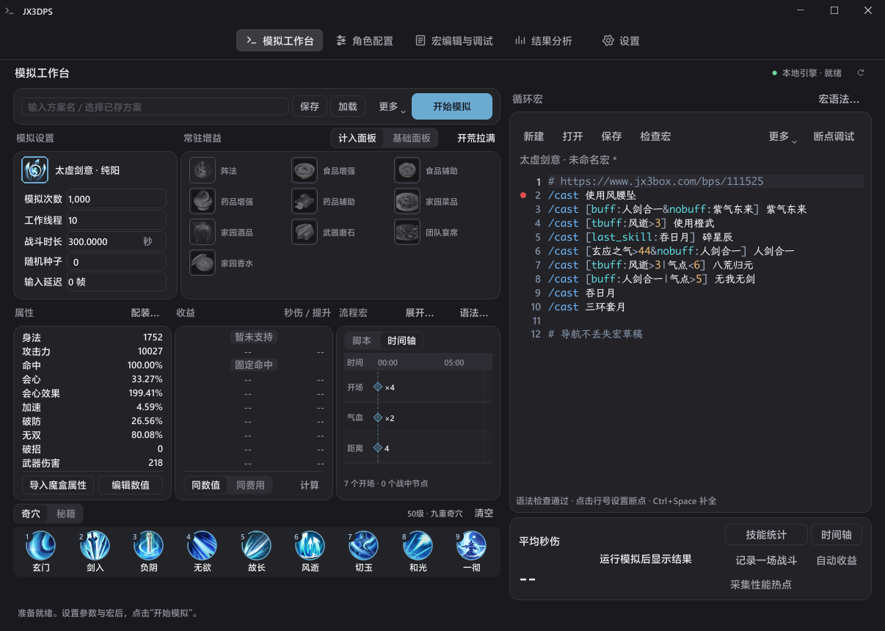
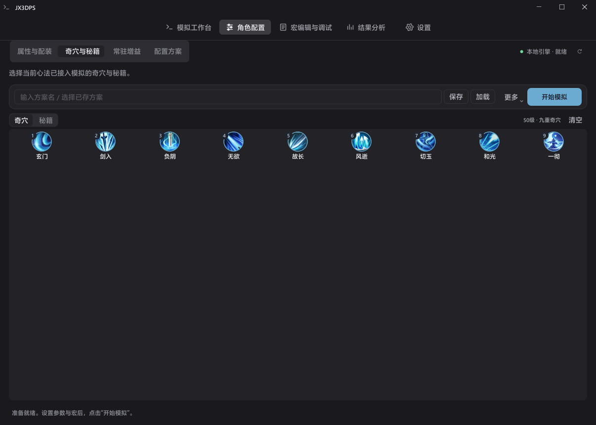
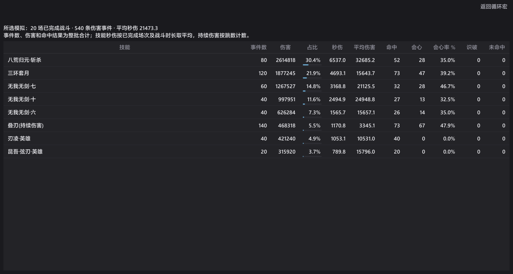
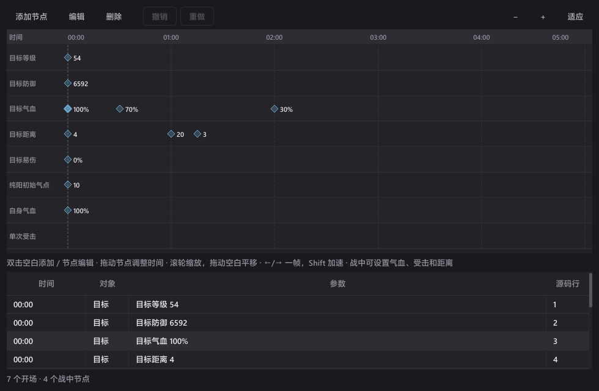

# JX3DPS 模拟器｜苍生铸世 · 50 级旗舰版

> 2026 年 11 月 24 日更新。**本次帖子重写、GCC 性能优化与本文引用的本地性能对照由 AI（OpenAI Codex）完成。** 原项目开发、心法资料和实测支持的贡献者列在「鸣谢」与「联合创作」中。

## 简介

JX3DPS 是一个开源的剑网 3 PVE 模拟器。想知道换装备能多打多少 DPS，或同一套宏为什么少打了几次关键技能，可以把自己的属性、奇穴、秘籍和宏放进来跑木桩。程序在本地逐帧判断施法、资源、调息、命中和增益；可以汇总许多场的平均 DPS，也可以回到单场查看哪一帧发生了什么。

### 模拟次数与精度

调宏先看一场的技能顺序，再用多场比较 DPS。比较两套配装时，固定宏、木桩等级、战斗时长、增益和随机种子，只改要验证的属性。「模拟历史」里的**秒伤标准差**表示单场之间的波动；要估算平均 DPS 的标准误，可用标准差除以模拟场数的平方根。比如标准差为 1,000 DPS，跑 10,000 场，平均值的标准误约为 10 DPS。两项属性收益很接近时，可换几个种子复测排序。

### 当前进展

当前支持苍生铸世 **20 个旗舰输出心法**，可直接使用各自的默认宏和预设。桌面工作台支持属性与配装、奇穴与秘籍、常驻增益、副本满增益预设、宏断点调试及可视化流程时间轴。默认宏顶部附有对应魔盒手法来源。[各心法默认宏与预设](https://github.com/Nowaterisenough/JX3DPS/blob/master/docs/season50_presets.md)

心法清单：傲血战意、北傲诀、冰心诀、毒经、分山劲、焚影圣诀、孤锋诀、花间游、凌海诀、莫问、山海心诀、天罗诡道、太虚剑意、太玄经、无方、笑尘诀、易筋经、幽罗引、周天功、紫霞功。

各心法已接入的效果可查[机制覆盖说明](https://github.com/Nowaterisenough/JX3DPS/blob/master/docs/season50_coverage.md)。例如，幽罗引的自动千里急、手动千里急与生地狱共享傀儡公调；未选绞网时，普通寄线的布线碰撞仍缺实测。界面中提示“当前木桩模拟尚未结算此效果”的秘籍，保留在配装方案中，但暂不计入伤害。[幽罗引实测对照](https://github.com/Nowaterisenough/JX3DPS/blob/master/docs/season50_yly_skill_shares_20261124.md)

## 下载地址

**[下载 Windows x64 GCC 便携版 5.42.261124.45（ZIP，约 101 MiB）](https://github.com/Nowaterisenough/JX3DPS/releases/download/5.42.261124.45/JX3DPS-windows-x86_64-gcc-16.2.0.zip)**　·　[查看最新稳定版及其他平台](https://github.com/Nowaterisenough/JX3DPS/releases/latest)

把整个 ZIP 解压到有写入权限的文件夹，双击 `JX3DPS Desktop.exe`。第一次从 0.37 / 0.38 旧版升级，建议解压到新文件夹。此后的更新可在「设置 → 关于 → 检查更新」中操作，启动工作台时也会自动检查。看到更新内容后，点「下载更新包」，校验完成再点「替换并重启」。

### 版本与更新记录

| 版本 | 更新内容 |
|---|---|
| [5.42.261124.45](https://github.com/Nowaterisenough/JX3DPS/releases/tag/5.42.261124.45) | 增加桌面新版提示和便携包原地更新；修正幽罗引千里急联动、傀儡公调与技能增益归属。 |
| [5.42.261123.42](https://github.com/Nowaterisenough/JX3DPS/releases/tag/5.42.261123.42) | 修正分山劲盾飞出手、施加虚弱和切擎刀的帧序，补充在线木桩同条件回放。 |
| [5.42.261123.40](https://github.com/Nowaterisenough/JX3DPS/releases/tag/5.42.261123.40) | 20 个心法拆分为独立实现，统一 50 级逐帧模拟入口，收录推荐配装下的重测结果。 |
| [5.42.261123.38](https://github.com/Nowaterisenough/JX3DPS/releases/tag/5.42.261123.38) | 接入苍生铸世 20 个旗舰输出心法、副本满增益预设，按第四版规则校正直伤和持续伤害系数。 |

**GCC 性能实测。** 在同一台 i7-12700 上，用 Windows GCC 16.2.0 对比普通 Release 和 PGO 版。每心法每轮 4,096 场，单场 300 秒、单线程，交替测三轮。20 个心法各自的耗时中位数合计从 **26.52 秒降到 22.85 秒，减少 13.8%**；两版逐轮总伤害与校验值一致。正式发布基准单列每心法每轮 10 万场的结果。[本地逐心法数据](https://github.com/Nowaterisenough/JX3DPS/blob/master/docs/desktop_pgo.md)　·　[全心法发布构建](https://github.com/Nowaterisenough/JX3DPS/actions/runs/45328099885)

### 原帖历史更新记录

下表保留原帖从 Demo 到 0.38 的版本脉络。旧版的数值、界面和秘籍范围对应当时的赛季。

| 版本 | 当时的主要改动 |
|---|---|
| 0.38.231211.2000 | 同步当期技改。 |
| 0.38.231028.1914 | 同步技改，更新小吃、小药与宴席。 |
| 0.38.231016.2336 | 加入凌雪阵、万灵阵，同步天罗天绝数值。 |
| 0.38.231014.2053 | 修复莫问阵眼精妙的计算，更新莫问默认属性及界面库。 |
| 0.38.231012.1448 | 同步技改，加入莫问阵眼效果。 |
| 0.38.230926.1831 | 校对莫问技能伤害，修正切曲风导致的部分技能偏低。 |
| 0.38.230924.624 | 修复部分系数、五音六律和目标气血／距离事件异常，修正大批量模拟溢出，重构伤害计算。 |
| 0.37.230915.2353 | 增加调试时间轴，可查看技能序列；同步体服技改。 |
| 0.37.230908.725 | 加入莫问水特效与橙武，修复切换宏后强制施放未打断读条。 |
| 0.37.230906.917 | 开放魔盒属性导入与第三方增益，支持双击修改属性，修复闪退。 |
| 0.37.230821.1211 | 重构运行逻辑，加入顺序宏、多段宏和逻辑帧精度选项，初步接入莫问。 |
| 0.37.230718.1040 | 修复未选常驻增益及部分目标增益判定时的闪退。 |
| 0.37.230718.556 | 加入常驻小药、水特效与腰坠，修正三柴剑法、两仪化形及统计。 |
| 0.37.230714.336 | 加入技能判定统计、会心收益，修正期声、破招会心率与部分伤害。 |
| 0.37.230710.606 | 增加空爆与部分三方效果，实装太虚橙武 DOT 万象归元、云中剑，与持盈相关效果。 |
| 0.37.230708.928 | 加入详细统计，修复环月、云中剑、读条与属性收益计算。 |
| 0.37.230707.559 | 加入早期属性收益结果，修正 DPS 期望的时间计算。 |
| 0.37.230705.1154 | 首个 Demo 版本。 |

## 鸣谢

- 感谢 [@浮烟](https://www.jx3box.com/bbs/62800) 及其他魔盒成员提供平台与游戏数据支持。
- 感谢 [@Zeratulag](https://www.jx3box.com/author/6) 提供游戏数据帮助。
- 感谢 @唯满侠-直男 提供剑纯账号用于测试。

## 联合创作 & 反馈

| 原帖贡献方向 | 参与者 |
|---|---|
| 程序开发 | [@难为水](https://www.jx3box.com/author/2063) |
| 太虚剑意 | [@17X](https://www.jx3box.com/author/147381)、[@半刻情深](https://www.jx3box.com/author/16904)、[@端溪](https://www.jx3box.com/author/11432) |
| 莫问 | [@陈词](https://www.jx3box.com/author/29011)、[@秋白墨染霜](https://www.jx3box.com/author/278219)、[@幽音音](https://www.jx3box.com/author/14055) |
| 无方 | [@白夜](https://www.jx3box.com/author/3774) |
| 紫霞功 | @风逝、[@月慕青尘](https://www.jx3box.com/author/50049) |
| 分山劲 | 分山计算器群 |

**[反馈问题或提交实测记录](https://github.com/Nowaterisenough/JX3DPS/issues)**。请附软件版本、心法、宏或导出的配置 JSON、木桩等级与距离、战斗时长、模拟次数和种子。若与游戏实测不同，最有用的是第一项出现偏差的技能、命中次数，以及同场伤害明细或战斗日志。

## 界面

**模拟工作台。** 左侧选心法、设木桩和模拟参数，右侧查看或修改循环宏。首次使用可直接运行默认宏。



**角色配置 → 奇穴与秘籍。** 先对齐奇穴和秘籍，再比较同一招的次数与单击伤害。



**结果分析 → 技能统计。** 每行是一项伤害。先比次数，再比平均每击和占比；截图里的数字仅对应图中那次模拟。



**流程时间轴。** 如果木桩中途转阶段或目标移出攻击距离，可以在这里按时间添加和编辑节点。



## 使用指南

### 操作步骤

1. 在「模拟工作台」选择心法。在「角色配置 → 属性与配装」录入自己的属性或导入魔盒属性，再核对武器、套装、特效、奇穴和秘籍。
2. 选择常驻增益。裸桩和副本满增益分别保存为方案；要对照游戏录像，就按录像实际使用的阵法、小药和团队增益填写。
3. 设木桩等级、防御、距离、模拟时长和种子，检查默认宏后点「开始模拟」。比较五分钟木桩时，战斗时长填 300 秒。
4. 在「结果分析 → 技能统计」核对技能次数、会心次数和总伤害。技能打少了，进「宏编辑与调试」找第一次未能施放的按键；次数已经接近，再看命中增益和 DOT 快照。
5. 在「结果分析 → 属性收益」点「运行并计算属性收益」。「同数值」逐项加 100 点；「同属性费用」按本赛季同档五彩石参考量比较，攻击和属性等级加 208，武器伤害加 35。看加速时，同时检查不同技能的公共调息、读条和 DOT 间隔有没有少一帧。

### 技能宏语句手册

**判定优先级与条件语句。** 模拟器以 `&` 表示“且”、`|` 表示“或”，先处理 `&`。例如 `A|B&C` 表示 A 成立，或 B、C 同时成立。宏从上到下尝试，优先技能放前面。以 `#` 开头的整行是注释。[原帖引用的《剑三宏命令完整参考手册》](https://www.jx3box.com/tool/265)

**技能序列。** `/cast` 每轮尝试施放，`/fcast` 允许打断引导。`/scast` 和 `/sfcast` 是顺序行：这一行成功前会阻塞后续行，成功后本场仅执行一次。下面是太虚剑意的语法示例，完整循环以工作台随心法载入的默认宏为准。

```text
# 简化示例：有足够气点时优先打无我无剑，其余时间打三环套月
/cast [气点>5] 无我无剑
/cast 三环套月
```

**宏长度、多段宏与隐藏 Buff。** 工作台用一个多行编辑器保存当前心法的循环。移植游戏多段宏时，按奇穴、资源和增益条件整理段落；需要模拟固定起手时使用顺序行。游戏内单个宏按钮的长度限制，要在回填到游戏时另行检查。技能名与可判定的隐藏 Buff 可在当前心法的「宏语法」中查看，`Ctrl+Space` 可补全；点行号能设断点，`F10` 可逐行查看实际判定。

### 事件语句手册

当前界面称为「流程宏」。开场语句设置这场模拟的初始条件；带时间前缀的语句设置战中节点。时间写作 `分:秒`，以 1/16 秒为一帧；同一时间的节点按源码顺序执行。

```text
# 开场：54 级木桩，防御 6592，距离 4 尺
/set_target level=54 shield=6592 distance=4
# 30 秒进入半血，45 秒目标移到 12 尺，50 秒回到 4 尺
00:30 /set_target life=50%
00:45 /set_target distance=12
00:50 /set_target distance=4
```

`/set_target` 可在开场设目标等级、防御、气血、距离和易伤；战中可改目标气血和距离。`/set_player` 可设自身气血，`hit=30%` 表示受到相当于最大气血 30% 的一次伤害。太虚、紫霞的初始气点可在开场用 `qidian` 设置。单次模拟针对一个目标，流程宏最多 256 个节点。

### 模拟器宏与事件语句 Effect 表

| 写法 | 查询或设置的效果 |
|---|---|
| `buff:人剑合一`、`nobuff:人剑合一` | 自身指定增益存在、缺失 |
| `tbuff:风逝>3` | 目标的风逝高于三层 |
| `bufftime:钤束<6` | 自身钤束剩余时间低于 6 秒 |
| `skill_cd`、`skill_energy` | 查询指定招式的剩余调息（秒）或充能层数 |
| `last_skill:吞日月` | 上一次施放的技能是吞日月 |
| `/set_target life=50%` | 流程节点将目标气血设为 50% |
| `/set_player hit=30%` | 流程节点对自身结算一次 30% 最大气血的受击 |

上表列的是语法与例子。技能、资源、增益名称随心法变化，完整名单以对应心法的宏帮助为准。

## 其他

### 代码开源地址

[JX3DPS 源码（MIT）](https://github.com/Nowaterisenough/JX3DPS)　·　[50 级运行规则](https://github.com/Nowaterisenough/JX3DPS/blob/master/docs/season50_runtime.md)　·　[全部发布版本](https://github.com/Nowaterisenough/JX3DPS/releases)
